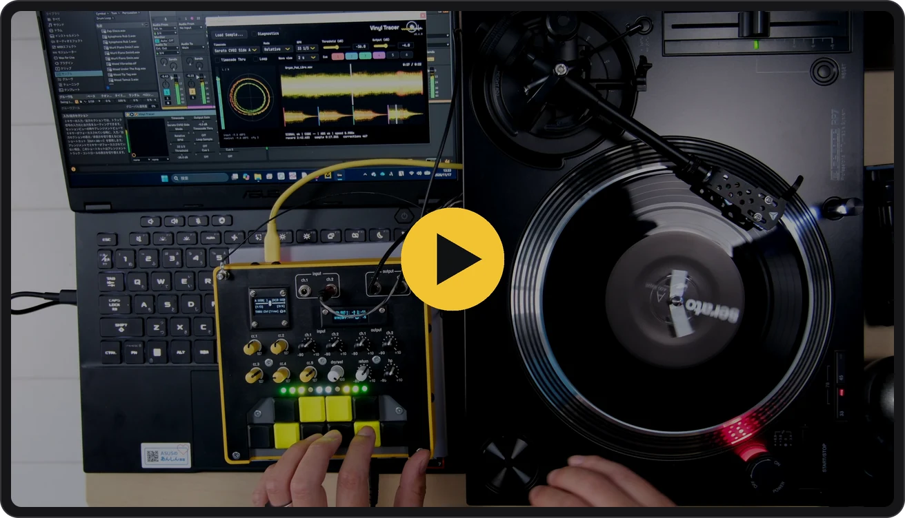

# Vinyl Tracer

English | [日本語](README_ja.md)


##
<a href="https://youtu.be/oCWPfKQkWZ8"></a>

## Screenshot


## Description
A VST3 / Audio Unit (AU) plugin for scratching a sample loaded into the plugin with Serato CV02 / CV02.5 or Traktor Control Vinyl MK2 timecode vinyl, in Ableton Live and other DAWs.

- **Windows** (10 / 11, 64-bit): VST3
- **macOS** (26 or later, Apple silicon / Intel): VST3 / AU (signed and notarized installer)

Releases can be downloaded from [Releases](https://github.com/yamamo2shun1/vinyl-tracer/releases). See [INSTALL.md](INSTALL.md) for how to install.

It was made for the moment in a DAW session when you think "what would this phrase sound like scratched?" and want to try it right away.

It aims to avoid, by design, three problems seen in existing plugins.

| Problem | Likely cause | What this implementation does |
|---|---|---|
| The position drifts after a few minutes of scratching | The position is the integral of the speed (errors add up) | The position comes directly from the measured carrier phase plus the absolute position from the LFSR. Nothing is integrated, so errors cannot add up. Cycle slips are detected in the bitstream and corrected automatically |
| The sound stops while the record is still moving slowly | The speed comes from the time between zero crossings, which hardly come at low speed | The phase of the L/R quadrature signal (atan2) is measured every sample and tracked by a third-order PLL. The position moves without waiting for zero crossings |
| High CPU load | (possibly from being built in M4L) | Written in C++. One deck at 48 kHz: 0.4 % for decoding + 0.4 % for playback (of one core, test machine) |

## Folder structure

```
core/      decoding and playback (C++17, no JUCE dependency)
  TimecodeDef.*      Serato CV02 / Traktor MK2 definitions and LFSR position tables
  TimecodeDecoder.*  timecode decoder
  ScratchPlayer.*    plays the sample from the position (interpolation + anti-aliasing)
plugin/    JUCE plugin layer (Processor / Editor)
tests/     accuracy tests with synthetic timecode
tools/     tc_analyze: analyses a WAV recorded from a turntable
           macos_sign_notarize.sh / macos_package.sh: signing, notarizing and .pkg for macOS
docs/      test results
```

## How the decoder works

1. **DC removal and L/R correction**: the L/R gain mismatch and phase error (quadrature error) are estimated and corrected all the time. The estimates are updated only while the carrier is fast enough (0.2x or more).
2. **Doubled-angle phase tracking**: `atan2(2LR, R²−L²)` (2θ) is tracked by a third-order PLL.
   - It is not affected by overall level changes. A cartridge's output falls as the speed drops.
   - It is not affected by the polarity flip when the record turns backwards. A magnetic cartridge puts out a voltage proportional to the speed, so the signal inverts when the record reverses.
3. **Absolute position from the LFSR**: the bits are read for all 8 combinations of channel order, polarity and direction in parallel, and the right one is chosen automatically. It works even with L/R swapped.
   - After 24 bits in a row match, the absolute position is fixed as "tracked phase + offset".
   - The position is matched to the half cycle only from readings while playing forward at 0.6–2.0x. The RIAA phase response is nearly flat in this range. Below it, at 50–500 Hz, the preamp acts like an integrator and the reading moves by half a cycle.
4. **Correction**: small errors (up to 4 cycles) are corrected slowly at 25 cycles/s. The pitch changes by 2.5 % at most and there is no click. Large errors (needle drops) jump at once, joined by a short cross-fade.
   - **Fast correction**: while scratching, the shock of grabbing and pulling the record back, or the stylus skating, can make the tracker miss part of the motion. So the bits are also read while the record is moved by hand or pulled back (0.3–6x), and the last 40 bits are matched near the predicted position (±256 cycles) to correct it.
   - While moving by hand the level changes quickly, so each bit is decided by comparing it with the mean of the same peak over the 3 cycles before and after. Bit errors drop from 10–15 % to 3–5 %. Matching allows up to 3 wrong bits.
   - Outside forward 0.6–2.0x, only whole cycles are corrected. After the stylus skated and the carrier was lost, the search range widens to ±2048 cycles.
5. **Gate**: the higher of the user threshold and the noise floor + 8 dB. Below it, tracking stops and the record slows to a stop.
6. **Traktor Control Vinyl MK2**: the carrier is 2.5 kHz, and the bits are not in the peak levels but in an offset common to both channels (L+R) that steps every 2.5 cycles (a 22-bit LFSR).
   - The offset is estimated and removed from L+R, and the phase is tracked by the same doubled-angle PLL. The bits are read from the offset.
   - Unlike Serato, the bits also read correctly backwards, so the absolute position locks while the record turns backwards too (0.3–2.5x).

## Test results with synthetic signals

The test signals model a real turntable: a cartridge (proportional to speed, inverted when reversed), RIAA de-emphasis, an L/R gain mismatch of 0.85, a quadrature error of 8°, DC offset, hum and noise (−60 dB). They run at 48 kHz with 128-sample blocks (v0.5.2, Windows, Visual Studio 2022 Release build, `docs/results_decoder.txt`).

| Scenario | Result |
|---|---|
| 1x playback, 20 s | lock 61 ms, spread p99 0.025 ms, drift 0.000 ms |
| Slow (0.2x → 0.01x, back and forth) | max error 1.1 ms, tracking stopped 0 % |
| Random scratching, 5 min (up to 4x, high acceleration) | p99 0.71 ms, max 1.3 ms, **drift after 5 min −0.18 ms** |
| Same, 5 min (flicks up to 8x) | p99 0.73 ms, max 1.2 ms, drift −0.08 ms |
| Needle drop (lifted for 0.3 s, dropped elsewhere) | locks to the new position in 63 ms |
| L/R swap and polarity inversion (4 combinations) | all detected automatically and locked |
| 44.1 kHz / 96 kHz / 1024-sample blocks | same accuracy |
| Noise and hum −40 dB (poor setup) | p99 2.2 ms, max 15 ms. On a real setup, raise the Threshold |

`docs/results_player.txt` has the results of the test that runs from decoding through playback.
- The position jitter (above 100 Hz) was 16 µs RMS, less than one sample (20.8 µs).
- There is a constant offset of about 0.2 ms. It comes from the phase of the cartridge and RIAA, and acts like a fixed delay, so it cannot be heard.

**Note**: the figures above are from synthetic signals. Locking and scratch playback have also been confirmed with real records: Serato (CV02 / CV02.5) and Traktor Control Vinyl MK2 (both sides). You can check the signal of your own setup as described in "Checking with a recorded WAV" below.

## Building

Requirements: CMake 3.22 or later and a C++17 compiler (Xcode on macOS, Visual Studio 2022 on Windows).

```bash
cd vinyl-tracer
git clone --depth 1 https://github.com/juce-framework/JUCE.git   # if present, FetchContent is not used
cmake -B build -DCMAKE_BUILD_TYPE=Release
cmake --build build --config Release
```

- The VST3 is built at `build/VinylTracer_artefacts/Release/VST3/Vinyl Tracer.vst3`.
  - On macOS, copy it to `~/Library/Audio/Plug-Ins/VST3/`.
  - On Windows, copy it to `C:\Program Files\Common Files\VST3\`.
- On macOS an AU (`.component`) is built as well.
  - For the universal binary for distribution (Apple silicon + Intel), build into `build-mac` with `-DCMAKE_OSX_ARCHITECTURES="arm64;x86_64" -DCMAKE_OSX_DEPLOYMENT_TARGET=11.0`.
  - Signing and notarizing are done with `tools/macos_sign_notarize.sh`, and the installer (.pkg) with `tools/macos_package.sh`. They need Developer ID certificates from the Apple Developer Program (see the top of each script for usage).
- To build only the tests and tools, add `-DVT_BUILD_PLUGIN=OFF` (no JUCE needed).

## Usage

Vinyl Tracer is an audio effect plugin. Feed it the timecode from a turntable as a stereo input, and it plays the loaded sample following the record's motion.

1. Insert "Vinyl Tracer" on an audio track that receives the (stereo) input of the audio interface the turntable is connected to. Turn on the track's input monitoring so that the input reaches the plugin.
2. Load a sample with `Load Sample...` or by drag and drop.
3. Play the record. When a circle shows in the scope and the status reads `SIGNAL ok / CODE ok / ABS ok`, it is ready.
4. By default, the position where the timecode first locks becomes the start of the sample. To start from another point, use cue points (next section).
5. Any buffer size works. The delay from moving the record to hearing the sound is set mostly by the DAW's buffer size, so a small value of around 64–128 samples is recommended for scratching.

### Cue points

The Cue buttons 1–6 store up to 6 positions in the sample.

- Ctrl+click (Cmd+click on macOS): stores the current playback position as the cue (overwrites it).
- Click: plays from that cue (nothing happens on an empty button).
- Alt+click (Option+click on macOS): deletes the cue.

**Where they are saved**: cues are saved per sample in the user's settings folder. Loading the same sample brings its cues back, in other projects and on other tracks too. Samples are recognised by their audio content, so the cues stay with a file that is moved or renamed (but not with one whose audio is edited or re-encoded).

| OS | Location |
|---|---|
| Windows | `%APPDATA%\Vinyl Tracer\cues.json` |
| macOS | `~/Library/Application Support/Vinyl Tracer/cues.json` |

`cues.json` is plain JSON and can be edited by hand: each entry has `cues`, the positions of Cue 1–6 in seconds (`null` = empty). `name` and `path` show where the file was last loaded from; `fingerprint` identifies the audio and should be left as it is. Cues saved by version 0.6.x (`cues.xml`) are carried over automatically.

**MIDI control**: playing from a cue also works from the buttons of a MIDI controller. Map the plugin parameters `Cue 1`–`Cue 6` to buttons with your DAW's MIDI mapping (MIDI learn). Each press plays from that cue. Both momentary buttons and toggle buttons work.

### Parameters

| Parameter | Description |
|---|---|
| Timecode | Serato CV02 Side A / Side B, Traktor MK2 Side A / Side B |
| Mode | Absolute (stylus position = sample position; follows needle drops) / Relative (uses only the motion; ignores needle drops) |
| RPM | 33 1/3 / 45 |
| Threshold | gate threshold (relative to the nominal level, dB). Raise it when there is a lot of hum or noise |
| Output | output gain |
| Timecode Thru | passes the input timecode through unchanged (for checking the routing) |
| Loop | loops the sample |
| Wave view | width of the scrolling waveform view |
| Cue | stores, recalls and deletes cue points (6) |
| Cue 1–6 (parameters) | play from that cue when turned on (for MIDI mapping; turns off again right away) |

## Checking with a recorded WAV (recommended)

Before trying the plugin, you can check that the decoder works with the signal of your own turntable.

1. Record the timecode from the turntable as a 48 kHz stereo WAV with no effects. These four recordings are useful:
   - normal playback (30 s)
   - slow movement back and forth
   - heavy scratching
   - needle drops
2. Analyse it with `tc_analyze`.

```bash
./build/tc_analyze rec_play.wav --side A --csv play.csv
```

For Traktor Control Vinyl MK2, use `--side MK2A` or `--side MK2B`.

It shows the time to lock, the share of time locked, the number of corrections and the detected wiring configuration. The CSV has the record position, speed and lock state every 1 ms; plotted, it shows position jumps and low-speed tracking.

## Not yet supported / next steps

- Absolute position for other records (Traktor MK1, djay Control Vinyl). Relative mode works in principle with a 1 kHz quadrature tone, but detecting the direction automatically needs the LFSR.
- Timecode CDs, and testing 45 rpm with a real turntable
- Fine-tuning the sound at high speed. Aliasing is currently reduced by cross-fading to half-rate copies of the sample according to the speed.
- Loading long files on a separate thread
- Working with a small Max for Live device (to use the audio of Live's clips)

## License

Vinyl Tracer is released under the [GNU Affero General Public License v3.0](LICENSE.md) (or any later version, `AGPL-3.0-or-later`). This covers all of `core/`, `plugin/`, `tests/` and `tools/`.

- `core/` contains no third-party code.
- The plugin uses [JUCE](https://juce.com/) under the terms of AGPLv3.
- The VST3 SDK (included with JUCE) is under the MIT license.
- The fonts embedded in the plugin (`fonts/`) are both under the SIL Open Font License 1.1.
  - [Space Grotesk](https://github.com/floriankarsten/space-grotesk) (plugin name): [fonts/OFL-SpaceGrotesk.txt](fonts/OFL-SpaceGrotesk.txt)
  - [JetBrains Mono](https://github.com/JetBrains/JetBrainsMono) (all other text): [fonts/OFL-JetBrainsMono.txt](fonts/OFL-JetBrainsMono.txt)

Serato is a trademark of Serato, and Traktor is a trademark of Native Instruments. Vinyl Tracer is not affiliated with either company; the names are used only to identify the supported timecode records.
